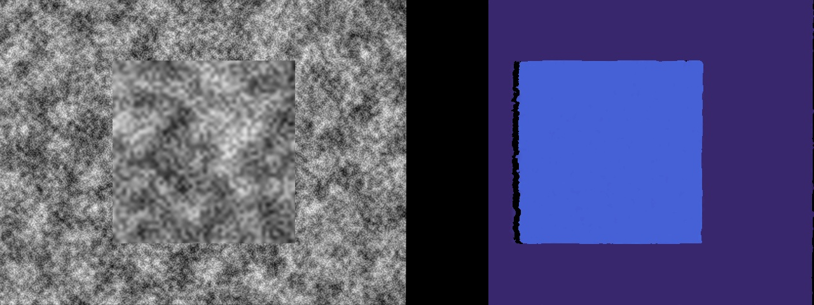

# multicam-depth

Depth from the two (or more) rear cameras of one Android phone, used as a stereo pair.

- **`android/`** – app that streams two physical cameras at once, shows a live depth
  map, and records frame pairs with per-frame sensor timestamps and IMU data.
- **`tools/`** – Python package that turns a recording into depth maps and point
  clouds, using the same algorithm as the app at full resolution.

MIT licensed. Only dependency beyond the platform is OpenCV (Apache-2.0).



## Status

| Part | State |
|---|---|
| Geometry (pose, rectification, alignment fit) | Tested in Python and Kotlin |
| Depth pipeline (Python) | Tested end to end on rendered scenes with known depth |
| Android app | Compiles and builds; **not yet run on a phone** |

The camera, recording and on-device OpenCV code has had no device testing. Expect
to fix things on first run; the info panel in the app prints what the phone reports.

## How it works

1. **Find a pair.** The app lists logical multi-cameras and their physical cameras
   (Camera2 `setPhysicalCameraId`). The narrower lens becomes the reference.
2. **Calibration from the phone.** Intrinsics, distortion and lens poses are read from
   `CameraCharacteristics`. Missing intrinsics are derived from focal length and sensor
   size. If no lens positions are published, a 12 mm baseline is assumed, depth is
   labelled relative, and a button cycles the assumed camera layout.
3. **Rectify.** Both images are warped so that a scene point lands on the same row
   (or column, for cameras stacked along the image's y axis) at the narrower lens's
   focal length.
4. **Re-align from image content.** Factory calibration is rarely good to a pixel, so
   ORB feature matches are used to fit and remove the leftover row misalignment.
5. **Match.** OpenCV semi-global block matching gives disparity `d`; depth is
   `focal_px * baseline / d`.

### What to expect

Phone cameras sit about 1 cm apart, so depth resolution falls off quickly. At
640 px wide with a main-camera lens, one pixel of disparity is roughly 5 m, so
usable depth is about 0.1 m to 2 m live, and about twice that from full-resolution
recordings. Textureless surfaces give no reading (shown black).

## Build the app

```bash
cd android
```

```bash
./gradlew assembleDebug
```

```bash
adb install app/build/outputs/apk/debug/app-debug.apk
```

Needs Android 9+ and a phone that exposes its physical cameras to third-party apps
(most Pixels, many recent Samsung, Xiaomi and OnePlus models). If none is found the
app says so and lists what the phone does expose.

In the app: pick a pair, point at something textured 0.2 to 1.5 m away. **Re-align**
redoes step 4 for the current scene. **Record** writes a session; **Share last** zips it.

## Process a recording

```bash
adb pull /sdcard/Android/data/dev.multicamdepth/files/session_20261117_120000
```

```bash
pip install -e tools
```

```bash
python -m mcdepth.cli process session_20261117_120000 --ply
```

Writes `depth/NNNNNN_depth_mm.png` (16-bit millimetres), a side-by-side preview and
optional point clouds. No phone yet? `python -m mcdepth.cli demo demo_session` writes
a synthetic recording to try it on.

Recording layout: [docs/session-format.md](docs/session-format.md).

## Tests

```bash
pytest tools
```

```bash
cd android && ./gradlew testDebugUnitTest
```

## Known limits

- Timestamps come from each sensor; frames are paired when within 16 ms. Whether the
  sensors are hardware-synced is recorded as `sync_type`.
- Autofocus and optical stabilisation shift the real intrinsics. OIS is switched off;
  focus is left automatic.
- Recordings are JPEG sequences, not video; pairs are skipped (and counted) if
  storage cannot keep up.
- Assumes intrinsics refer to the full active array, centre-cropped to the stream.
